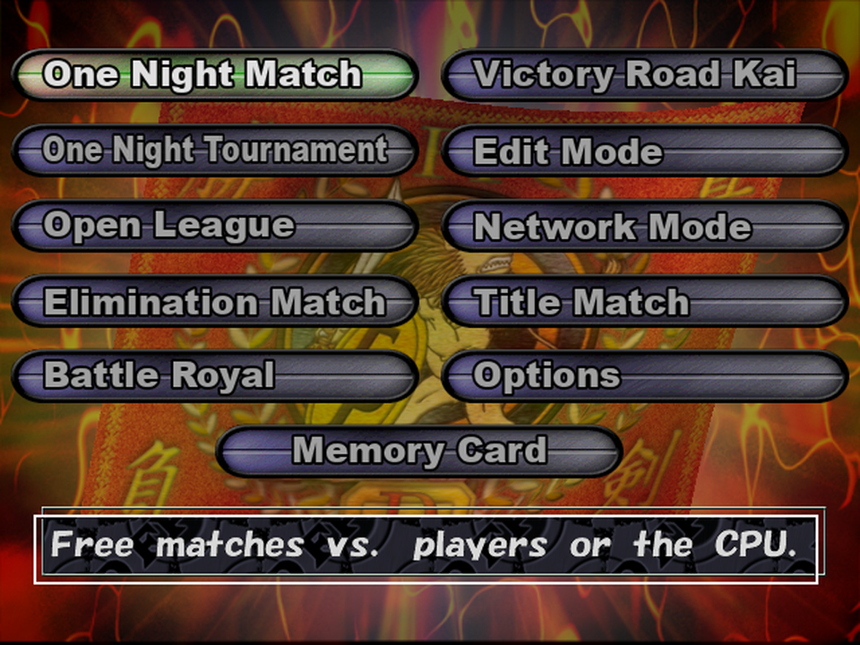
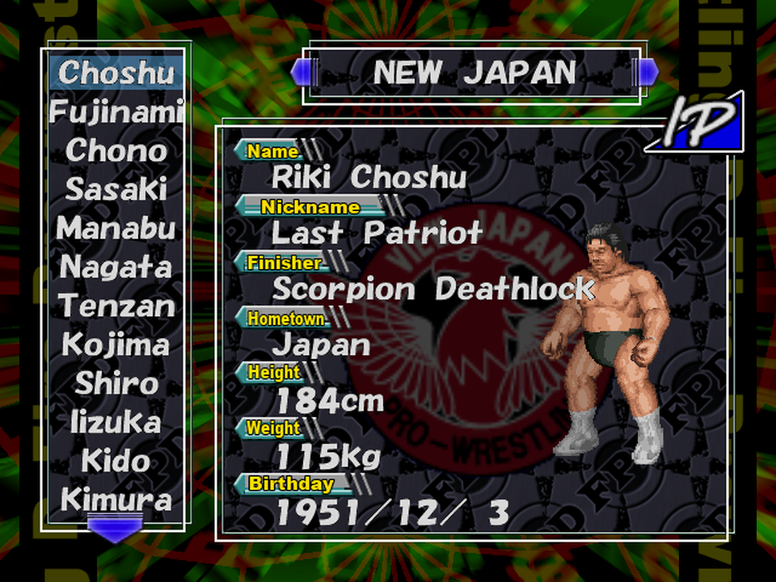
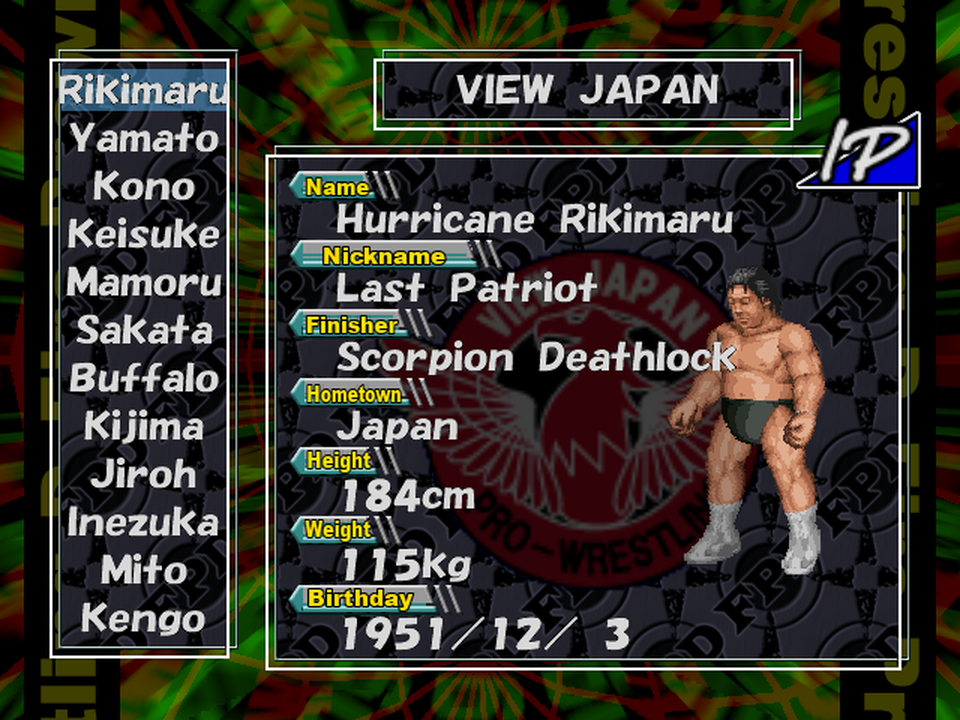
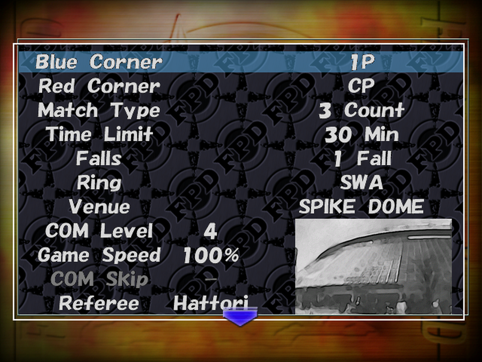
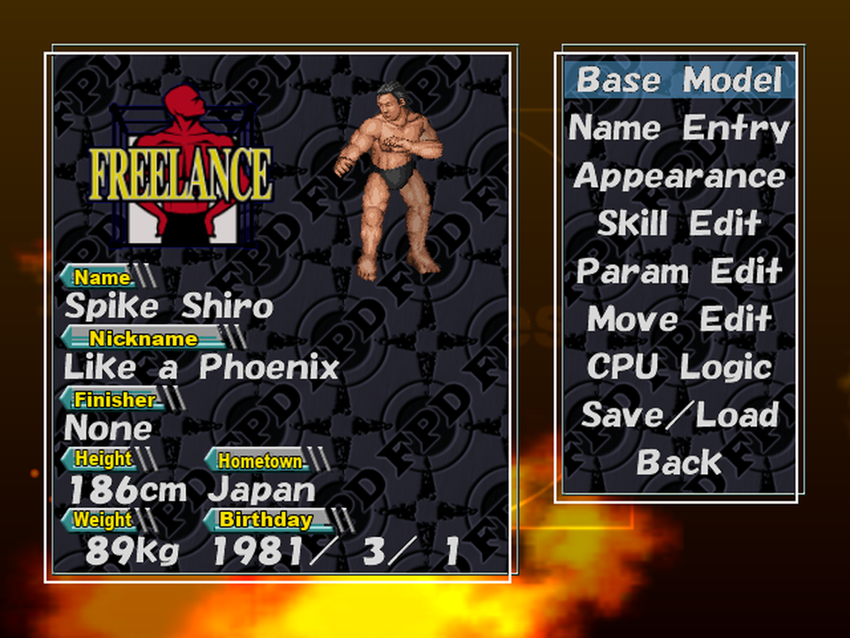
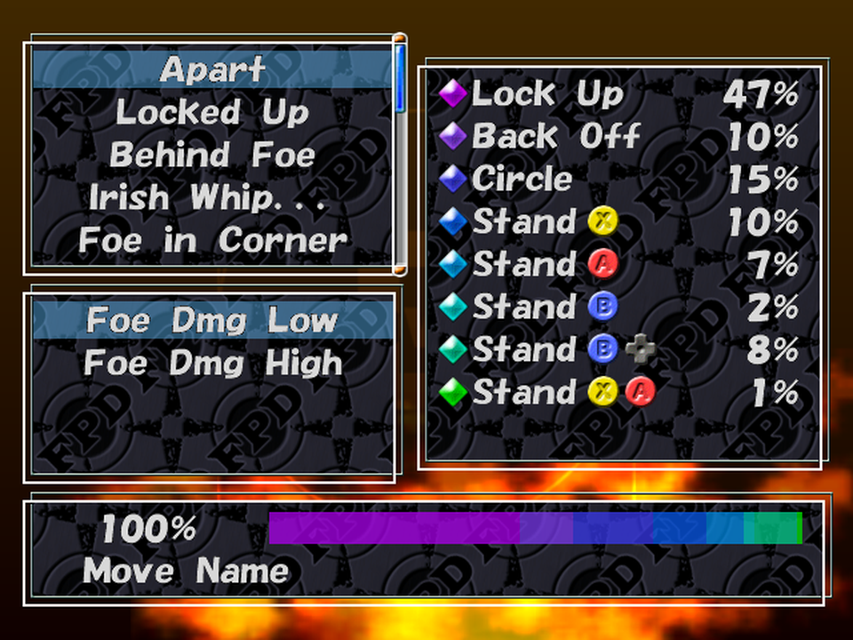
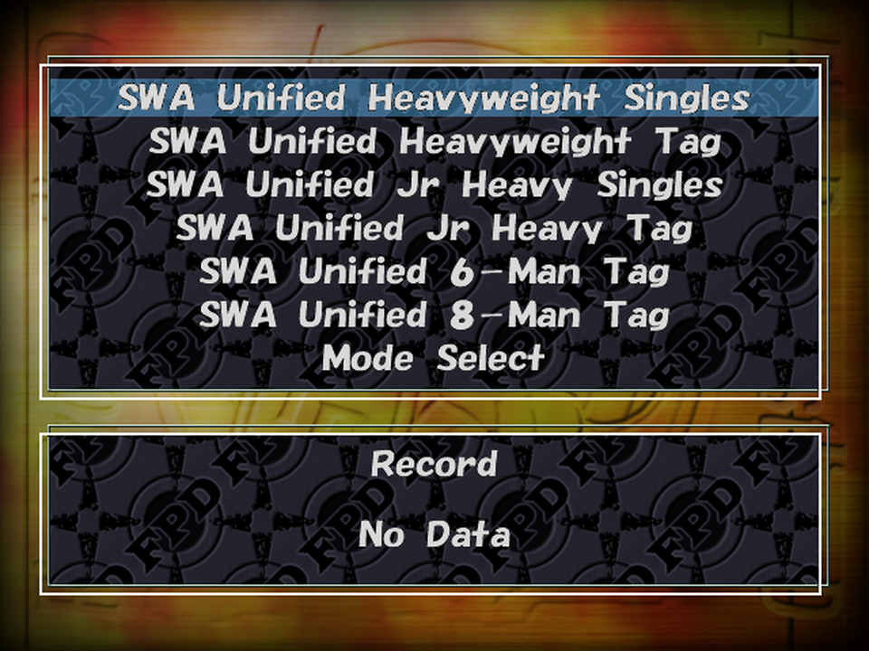
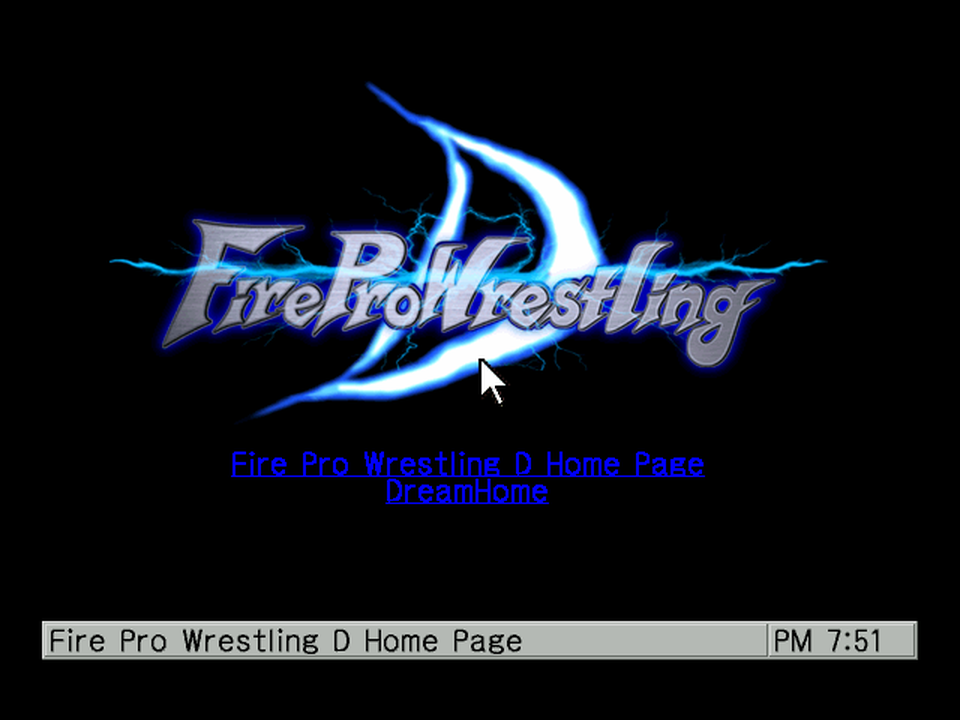

# Screenshots

Fire Pro Wrestling D with the English patch, at the Dreamcast's native 640x480 (shown here at
960x720), taken in Flycast. Real names unless marked.

## Main menu

Every mode plus Options and Memory Card. The menu buttons are redrawn pictures, and the help line under them changes
with the cursor.

## Wrestler select (Real Names)

The 220-wrestler roster, each with a name, nickname, finisher, hometown, height, weight and
birthday. The field tags were redrawn in English.

## Wrestler select (Parody Names)

The same screen in the Parody Names patch, with the names the game gave its wrestlers.

## Match settings

Every rule, ring, venue and referee setting for One Night Match.

## Edit Mode

Edit Wrestler: the profile card and every editing menu, from Name Entry to Save/Load.

## CPU Logic

The editor for how a CPU wrestler fights: situations, move slots and how likely each one is.

## Victory Road Kai

The title-chase mode. Its championships, records and progress screens are all in English.

## Network mode

The built-in DreamPassport 3 browser. Its messages, menus, settings and keyboard labels are
translated, and its 13 sheets of button and title pictures were redrawn. Sega's servers are long
gone, so the online pages can't be reached anymore.
